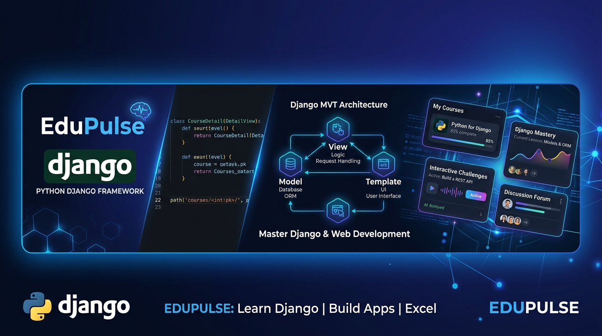
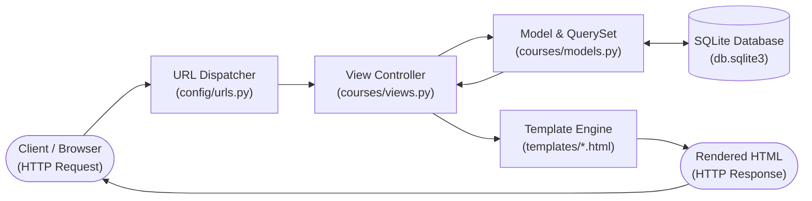
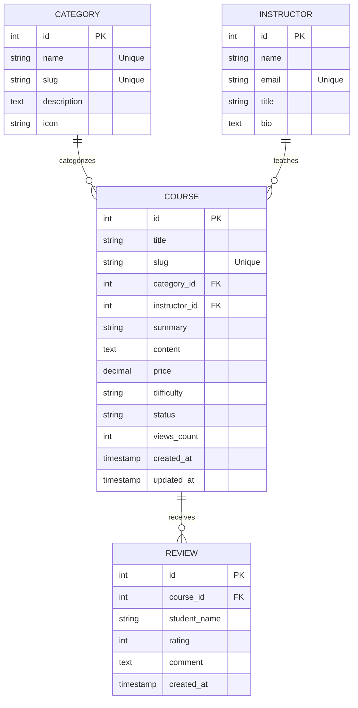

<div align="center">



# EduPulse: Python Django Web Framework Portal

[](https://www.python.org/)
[](https://www.djangoproject.com/)
[](https://www.sqlite.org/)
[](https://tailwindcss.com/)
[]()

**An interactive, presentation-ready web application designed specifically to demonstrate and master Unit V: Django (18 Hours) from *K.A. Lambert, "Fundamentals of Python: first programs", Second Edition*.**

[Live Features](#-live-features--seminar-demos) • [Unit V Syllabus Mapping](#-unit-v-syllabus-mapping) • [Step-by-Step Setup](#-step-by-step-setup-guide) • [Admin & CLI Commands](#-admin-credentials--commands-cheat-sheet) • [Architecture](#-mvt-architecture--er-diagram) • [Seminar Talking Points](#-seminar-presentation-guide) • [Viva Q&A](#-top-viva--seminar-questions)

---

</div>

## 📌 Project Overview

**EduPulse** is an interactive Course & Knowledge Management web application developed with Python and Django. Rather than an abstract corporate backend, it is engineered specifically as a **live educational demonstrator** that brings every topic in **Unit V (Django Web Framework)** to life in real-time.

### Key Highlights
- **100% Self-Contained:** Runs instantly using pure Python, Django, and SQLite. Zero external daemons required.
- **Interactive QuerySet Explorer (`/querysets/`):** A dedicated live playground in the browser that displays Python ORM expressions, the underlying SQL queries generated by Django, and the evaluated result sets.
- **Generic Class-Based Views (CBVs):** Complete `ListView` and `DetailView` implementations with search, faceted category filters, and pagination.
- **Function-Based View (FBV) Comparison (`/fbv/list/`):** Side-by-side implementations demonstrating the contrast between procedural views and class-based views.
- **Production-Ready Admin Panel (`/admin/`):** Advanced `ModelAdmin` features including `list_display`, `search_fields`, `list_filter`, `prepopulated_fields`, bulk actions, and `TabularInline` reviews.
- **Pre-Seeded Realistic Data:** Comes with courses, instructors, categories, student reviews, and an active superuser account.

---

## 🎯 Unit V Syllabus Mapping

Every single section from **Unit V: Django (18 Hours)** is implemented with clean code and live visual demonstrations:

| Syllabus Topic | Implementation File(s) | Live Seminar Demonstration |
| :--- | :--- | :--- |
| **1. Installing Django** | `requirements.txt` | Virtual environment creation & `pip install django` |
| **2. Project Creation** | `config/settings.py`, `manage.py` | `django-admin startproject config .` folder structure |
| **3. Building an Application** | `courses/apps.py` | `python manage.py startapp courses` & `INSTALLED_APPS` |
| **4. Designing the Data Schema** | `courses/models.py` | `Category`, `Instructor`, `Course`, `Review` models & Migrations |
| **5. Creating an administration site** | `courses/admin.py` | Custom `ModelAdmin` at `http://127.0.0.1:8000/admin/` |
| **6. Working with QuerySets and Managers**| `courses/managers.py` | Custom Manager `Course.published.all()`, chaining, lazy evaluation |
| **7. Retrieving Objects** | `courses/views.py` | `.get()`, `get_object_or_404()`, `.filter()`, `.aggregate()`, `.first()` |
| **8. Building List and Detail Views** | `courses/views.py`, `templates/` | `CourseListView` (`ListView`) & `CourseDetailView` (`DetailView`) |

---

## 🚀 Step-by-Step Setup Guide

Follow these steps to run the application on your computer:

### Step 1: Clone the Repository
```bash
git clone https://github.com/Arunachalam-gojosaturo/django-framework.git
cd django-framework
```

### Step 2: Set Up Python Virtual Environment
```bash
python3 -m venv .venv
source .venv/bin/activate
```
*(On Windows use: `.venv\Scripts\activate`)*

### Step 3: Install Dependencies
```bash
pip install -r requirements.txt
```

### Step 4: Apply Database Migrations
```bash
python manage.py makemigrations courses
python manage.py migrate
```

### Step 5: Seed Sample Data & Admin Superuser
Run the included seeding script to automatically populate courses, categories, instructors, reviews, and create the default admin superuser:
```bash
python populate_data.py
```

### Step 6: Start the Development Server
```bash
python manage.py runserver
```

Now open [http://127.0.0.1:8000/](http://127.0.0.1:8000/) in your web browser!

---

## 🔐 Admin Credentials & Commands Cheat Sheet

### Default Pre-Configured Staff Accounts

| Role | Username | Password | Status | Admin Privileges |
| :--- | :--- | :--- | :--- | :--- |
| **Superuser (Primary)** | `admin` | `admin123` | Active | Full Superuser & Staff Access |
| **Superuser (Backup)** | `staff` | `staff123` | Active | Full Superuser & Staff Access |

> **⚠️ Note on Case Sensitivity:**  
> Django usernames and passwords are case-sensitive. Enter them in all lowercase without trailing spaces.

---

### 🔑 Admin & User Management Commands

#### 1. Change an Existing Admin Password
To change the password for `admin` or any user directly from your terminal:
```bash
python manage.py changepassword admin
```
*You will be prompted to enter and confirm your new password in the terminal.*

#### 2. Create a Brand New Superuser Account
If you ever want to create an entirely new administrator account interactively:
```bash
python manage.py createsuperuser
```
*Follow the interactive prompts to provide a username, email address, and password.*

#### 3. Reset / Unlock an Account via Python Shell
If you ever need to reset a password programmatically via the interactive Django shell:
```bash
python manage.py shell
```
Inside the interactive shell:
```python
from django.contrib.auth.models import User
user = User.objects.get(username='admin')
user.set_password('my_new_secure_password')
user.is_staff = True
user.is_superuser = True
user.save()
exit()
```

---

### 🛠️ Complete Django CLI Commands Reference

Here is a master cheat sheet of every essential Django command used throughout the project and seminar:

| Command | Category | Description & Usage |
| :--- | :--- | :--- |
| `python manage.py runserver` | **Server** | Starts the local lightweight development web server on `http://127.0.0.1:8000/`. |
| `python manage.py runserver 8080` | **Server** | Starts the web server on a custom port (e.g., `8080`). |
| `python manage.py makemigrations courses` | **Database** | Inspects `courses/models.py` and creates Python migration blueprint files. |
| `python manage.py migrate` | **Database** | Executes DDL SQL statements to apply pending migrations to `db.sqlite3`. |
| `python manage.py showmigrations` | **Database** | Displays the status of all applied and unapplied migrations across all apps. |
| `python manage.py sqlmigrate courses 0001` | **Database** | Prints the exact raw SQL statements that will be executed for migration `0001`. Great for demonstrating ORM SQL generation during seminars! |
| `python manage.py dbshell` | **Database** | Opens the SQLite command-line client directly connected to `db.sqlite3`. |
| `python populate_data.py` | **Data Seed** | Populates courses, instructors, categories, reviews, and ensures default admin users exist. |
| `python manage.py changepassword <user>` | **Auth** | Changes the password for the specified user account. |
| `python manage.py createsuperuser` | **Auth** | Interactively creates a new superuser with administrative privileges. |
| `python manage.py test courses` | **Testing** | Runs all automated unit and integration tests defined in `courses/tests.py`. |
| `python manage.py check` | **Diagnostics**| Inspects the entire Django project for configuration or syntax errors without running the server. |
| `python manage.py shell` | **Interactive**| Launches an interactive Python REPL with Django models and settings pre-loaded. |
| `python manage.py startapp <app_name>` | **Scaffolding**| Scaffolds a new modular Django application directory structure. |
| `django-admin startproject <name> .` | **Scaffolding**| Creates the root project configuration files (`settings.py`, `urls.py`, `wsgi.py`). |

---

## 🖥️ Live Features & Seminar Demos

During your seminar presentation, open the browser to showcase these pages:

| Page | URL | Description |
| :--- | :--- | :--- |
| **Course Catalog (List View)** | `http://127.0.0.1:8000/` | Generic `ListView` with search, category filtering, and pagination. |
| **Course Details (Detail View)** | `http://127.0.0.1:8000/course/<slug>/` | Generic `DetailView` with view tracking, instructor card, and review form. |
| **QuerySet & Manager Explorer** | `http://127.0.0.1:8000/querysets/` | Live ORM runner displaying code, generated SQL, and result counts. |
| **Built-in Presentation Deck** | `http://127.0.0.1:8000/seminar/` | Presentation slides and talking points built directly into the app. |
| **FBV Comparison Page** | `http://127.0.0.1:8000/fbv/list/` | Demonstrates procedural Function-Based Views. |
| **Django Administration Panel** | `http://127.0.0.1:8000/admin/` | Management site (**Username:** `admin` \| **Password:** `admin123`). |

---

## 📐 MVT Architecture & ER Diagram

### 1. Django MVT (Model-View-Template) Architecture
Django utilizes the **MVT** architectural pattern:
* **Model (`courses/models.py`):** Encapsulates data schema and queries the SQLite database via the ORM.
* **View (`courses/views.py`):** Implements business logic, interacts with models, and renders templates.
* **Template (`templates/*.html`):** Renders HTML using Django Template Language (DTL).
* **URL Dispatcher (`config/urls.py`):** Acts as the controller by directing HTTP requests to their appropriate views.



### 2. Database Entity-Relationship (ER) Schema



---

## 🎙️ Seminar Presentation Guide (What to Say)

### 1. Topic 1: Installing Django
> *"Django is installed via Python's package manager `pip` within an isolated virtual environment (`python3 -m venv .venv`). This ensures project dependencies do not conflict with the global Python installation."*

### 2. Topic 2 & 3: Project Creation vs. Building an Application
> *"A Django **Project** (`config/`) is the global container that configures database connections, middleware, and root routing. An **App** (`courses/`) is a modular, self-contained sub-package that provides specific functionality and can be reused across different projects."*

### 3. Topic 4: Designing the Data Schema
> *"Instead of writing vendor-specific SQL `CREATE TABLE` statements, Django's ORM allows us to write Python classes inheriting from `models.Model`. We define fields like `CharField`, `SlugField`, and `ForeignKey` with `on_delete=models.CASCADE`. Migrations are handled with `makemigrations` (generates the migration blueprint) and `migrate` (executes the DDL on the database)."*

### 4. Topic 5: Administration Site for Models
> *"Django comes with a built-in admin site at `/admin/`. In `courses/admin.py`, we customize it using `ModelAdmin`:
> - `list_display`: Controls displayed columns.
> - `list_filter`: Right-side faceted sidebar filter.
> - `search_fields`: Instant full-text search.
> - `prepopulated_fields`: Automatically generates URL-safe slugs from the title in real-time as the admin types.
> - `inlines`: Renders related `Review` records directly inside the `Course` edit screen."*

### 5. Topic 6 & 7: Working with QuerySets, Managers & Retrieving Objects
> *"A **Manager** is the interface through which models interact with the database. We built a Custom Manager `Course.published = PublishedCourseManager()` that provides `Course.published.all()`, pre-filtering only published courses.
> 
> QuerySets are **lazy**: Django does not query the database when a QuerySet is defined; it only executes the SQL when evaluated (iterating in a template ``, slicing, or counting).
> 
> To retrieve objects:
> - `filter()`: Returns a QuerySet of matching records.
> - `get()`: Returns a single model instance; raises `DoesNotExist` or `MultipleObjectsReturned`.
> - `get_object_or_404()`: Shortcut that returns an HTTP 404 response cleanly if the object is missing."*

### 6. Topic 8: Building List and Detail Views
> *"Django provides generic Class-Based Views (CBVs) to eliminate boilerplate code:
> - `CourseListView(ListView)`: Automatically handles database querying, pagination, and template context.
> - `CourseDetailView(DetailView)`: Extracts the `slug` parameter from the URL, fetches the single course instance, increments the view counter, and renders the detail view."*

---

## ❓ Top Viva / Seminar Questions

<details>
<summary><strong>Q1: What is the difference between MVC and Django's MVT?</strong></summary>

In MVC, the Controller processes requests. In Django's MVT, the framework itself acts as the Controller through `urls.py`, while the View handles business logic and data retrieval, and the Template handles presentation.
</details>

<details>
<summary><strong>Q2: What is lazy evaluation in QuerySets?</strong></summary>

Creating a QuerySet does not execute a database query. Django only sends the SQL query to the database when the QuerySet is explicitly evaluated (e.g., in a template loop, `list()`, `len()`, or `count()`).
</details>

<details>
<summary><strong>Q3: What is the difference between `.filter()` and `.get()`?</strong></summary>

`.filter()` returns a QuerySet with zero or more items and never raises an error if no match is found. `.get()` returns a single model instance and raises `DoesNotExist` if 0 rows match, or `MultipleObjectsReturned` if more than 1 row matches.
</details>

<details>
<summary><strong>Q4: Why use a Custom Model Manager?</strong></summary>

To encapsulate common query filters (such as `Course.published.all()`) directly onto the model, keeping views clean and adhering to the DRY (Don't Repeat Yourself) principle.
</details>

<details>
<summary><strong>Q5: What is the difference between `makemigrations` and `migrate`?</strong></summary>

`makemigrations` inspects `models.py` and creates Python migration blueprint files in the `migrations/` folder. `migrate` reads those blueprints and applies the actual SQL schema changes to the database.
</details>

---

## 📁 Repository File Tree

```
django-framework/
├── docs/
│   └── edupulse_banner.jpg            # Generated project banner
├── config/
│   ├── settings.py                    # Master project configuration
│   ├── urls.py                        # Root URL routing
│   ├── wsgi.py                        # WSGI gateway
│   └── asgi.py                        # ASGI gateway
├── courses/
│   ├── admin.py                       # ModelAdmin customizations
│   ├── apps.py                        # App configuration
│   ├── forms.py                       # ModelForm for student reviews
│   ├── managers.py                    # Custom PublishedCourseManager
│   ├── models.py                      # Category, Instructor, Course, Review
│   ├── tests.py                       # Automated test suite (6 passing tests)
│   ├── urls.py                        # App routes (List, Detail, Explorer, Seminar)
│   └── views.py                       # CBVs (ListView, DetailView) & FBVs
├── templates/
│   ├── base.html                      # Tailwind CSS layout shell
│   └── courses/
│       ├── course_list.html           # Generic ListView template
│       ├── course_detail.html         # Generic DetailView template
│       ├── course_list_fbv.html       # Function-based list view
│       ├── course_detail_fbv.html     # Function-based detail view
│       ├── queryset_explorer.html     # Interactive live QuerySet explorer
│       └── seminar_guide.html         # In-browser presentation slides
├── static/
│   └── images/
│       └── edupulse_banner.jpg
├── populate_data.py                   # Automated database seeding script
├── manage.py                          # Django management script
├── requirements.txt                   # Dependency manifest
└── README.md                          # Master documentation
```

---

## 🧪 Automated Testing

Run the automated test suite to verify all models, managers, and views:

```bash
python manage.py test courses
```

Result:
```text
Ran 6 tests in 0.059s
OK
```

---

## 👨‍💻 Author & Acknowledgements

* **Author:** Arunachalam ([@Arunachalam-gojosaturo](https://github.com/Arunachalam-gojosaturo))
* **Curriculum Reference:** K.A. Lambert, *"Fundamentals of Python: first programs"*, Second Edition (Unit V)
